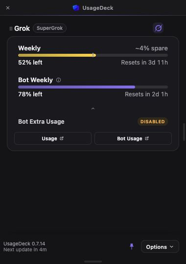

# Grok

UsageDeck tracks regular Grok and Grok Bot allowances in the same Grok card, plus usage recorded by
the Grok CLI. You can sign in to either product independently.

## What it tracks

| Metric                           | Meaning                                               |
| -------------------------------- | ----------------------------------------------------- |
| Weekly                           | Weekly allowance remaining                            |
| Bot Weekly                       | Grok Bot's included weekly allowance and reset time   |
| Shared Weekly                    | Shared Grok / Grok Bot / Cursor pool on unified plans |
| Bot Extra Usage                  | On-demand status and account spending cap            |
| Extra Usage                      | Pay-as-you-go availability reported by Grok           |
| Today / Yesterday / Last 30 Days | Tokens and estimated spend calculated from local logs |
| Usage Trend                      | Recent local usage over time                          |

Accounts that still use Grok's older billing model may not report a weekly pool, in which case the
Weekly row shows **No data**.

## Sign-in and local data

Sign in by running `grok login`. UsageDeck reads the authentication data and usage history stored by
the Grok CLI. `GROK_HOME` is respected when it is set.

Spend history is estimated locally from Grok's usage log and is not uploaded by UsageDeck.

For **Grok Bot**, sign in to the Grok Bot desktop app, then refresh UsageDeck. The reader follows
the active saved account and uses its encrypted sign-in without changing Grok Bot's files or
rotating its refresh token. macOS may ask you to allow access to **Grok Bot Safe Storage**. Windows
uses the current user's DPAPI key; Linux supports Electron's basic-text and Secret Service
storage backends. A local Cursor sign-in is also supported when no active Grok Bot login
is present.

Bot Weekly comes from Grok Bot's server meter, including work performed in the cloud or on another
device. Grok CLI token history does not include that cloud work. **Bot Extra Usage** reports the
Cursor account's monthly spending and cap, which can also cover Cursor work; it is not an isolated
Bot-only cost total. Pooled Enterprise accounts do not expose a personal weekly percentage.

On The X Subscription, **Shared Weekly** explicitly identifies the allowance shared by Grok,
Grok Bot, and Cursor. It is not an additional Bot allowance. The information icon explains which
products share it. Each available source remains visible if the other source cannot refresh.

UsageDeck reads internal product usage endpoints rather than an API-key billing dashboard. If an
endpoint or desktop credential format changes, the affected row can become unavailable.

## Troubleshooting

- **Not logged in** — run `grok login`, then refresh UsageDeck.
- **Login invalid or expired** — sign in again with the Grok CLI.
- **No local history** — use Grok normally and check the active `GROK_HOME` directory.
- **Billing request failed** — check the connection and try another refresh.
- **Grok Bot secure sign-in could not be read** — allow access to its secure storage, then refresh.
- **Grok Bot sign-in expired** — open Grok Bot so it refreshes its sign-in, then refresh UsageDeck.
  The reader does not rotate or overwrite the desktop app's credentials.

## Card preview

